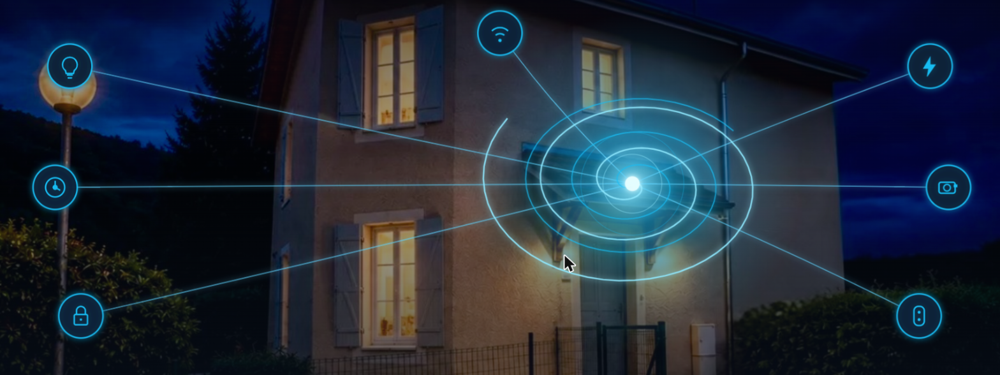

  

# Salut, je suis Frédéric 👋 · cyclope205

🇫🇷 Français | 🇬🇧 [English](#english)

---

### 📊 Statistiques GitHub · GitHub stats

---

## 🇫🇷 Français

Je développe des intégrations et cartes personnalisées pour **Home Assistant**, pensées pour être simples à installer (HACS) et agréables à utiliser au quotidien — suivi domestique, multimédia, cuisine, navigation.

### 🧩 Mes projets

| Projet | Description | Installer | Documentation |
|---|---|---|---|
| **[Suivi Stock Pellet](https://github.com/cyclope205/suivi-stock-pellet)** | Suivi de consommation et de stock de granulés de bois, avec graphiques et alertes de niveau |  | [README](https://github.com/cyclope205/suivi-stock-pellet#readme) |
| **[Programme TNT FR](https://github.com/cyclope205/programme-tnt-fr)** | Carte Lovelace affichant le programme TNT français avec affiches TMDB |  | [README](https://github.com/cyclope205/programme-tnt-fr#readme) |
| **[Recettes Express](https://github.com/cyclope205/recettes-express)** | Suivi du frigo/garde-manger avec suggestions de recettes par IA |  | [README](https://github.com/cyclope205/recettes-express#readme) |
| **[Sidebar Shortcuts](https://github.com/cyclope205/sidebar-shortcuts)** | Raccourcis personnalisés dans la barre latérale de Home Assistant |  | [README](https://github.com/cyclope205/sidebar-shortcuts#readme) |
| **[Changelog Traduction](https://github.com/cyclope205/changelog-traduction)** | Traduction automatique du changelog Home Assistant, avec notifications catégorisées |  | [README](https://github.com/cyclope205/changelog-traduction#readme) |

### 🛠️ Avec quoi je bricole

### ☕ Soutenir

Si un de mes projets t'est utile, un petit coup de pouce fait toujours plaisir :

---

## English

I build custom integrations and cards for **Home Assistant**, designed to be easy to install (HACS) and pleasant to use day to day — home monitoring, media, cooking, navigation.

### 🧩 My projects

| Project | Description | Install | Docs |
|---|---|---|---|
| **[Suivi Stock Pellet](https://github.com/cyclope205/suivi-stock-pellet)** | Wood pellet stock & consumption tracker, with charts and low-level alerts |  | [README](https://github.com/cyclope205/suivi-stock-pellet#readme) |
| **[Programme TNT FR](https://github.com/cyclope205/programme-tnt-fr)** | Lovelace card showing French TV listings with TMDB posters |  | [README](https://github.com/cyclope205/programme-tnt-fr#readme) |
| **[Recettes Express](https://github.com/cyclope205/recettes-express)** | Fridge/pantry tracker with AI recipe suggestions |  | [README](https://github.com/cyclope205/recettes-express#readme) |
| **[Sidebar Shortcuts](https://github.com/cyclope205/sidebar-shortcuts)** | Custom shortcuts for the Home Assistant sidebar |  | [README](https://github.com/cyclope205/sidebar-shortcuts#readme) |
| **[Changelog Traduction](https://github.com/cyclope205/changelog-traduction)** | Automatic translation of the Home Assistant changelog, with categorized notifications |  | [README](https://github.com/cyclope205/changelog-traduction#readme) |

### ☕ Support

If one of my projects has been useful to you, a little support always helps:

